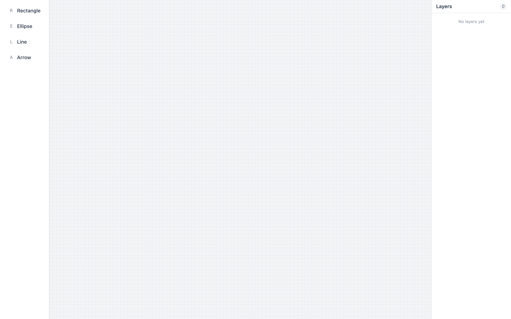
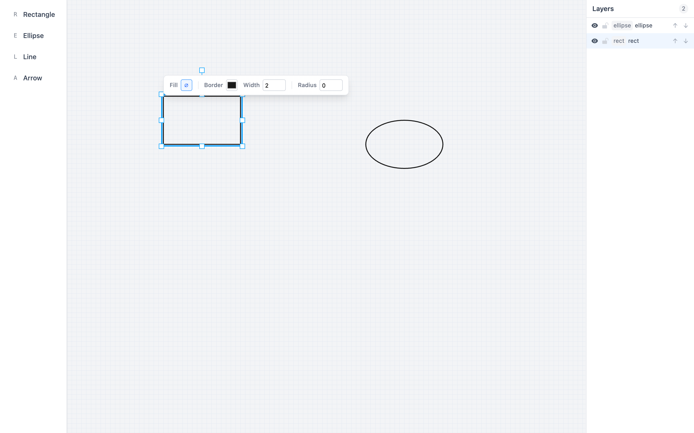
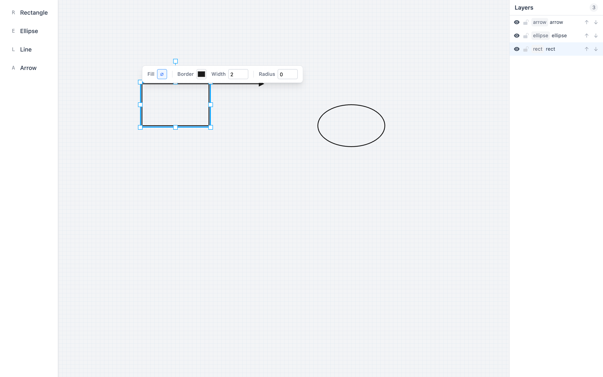

# mCanva

A canvas-based wireframing tool built with React, Konva, and Zustand.

Draw shapes, connect them with smart arrows, label them, and style them — all on a persistent Konva canvas with a fully test-covered codebase.

---

## Screenshots

### Empty canvas



*Left sidebar lists all tools with their keyboard shortcuts. The right sidebar shows the Layers panel. The canvas has a 10px snap-to-grid overlay.*

### Shapes and selection



*A rectangle and an ellipse placed on the canvas. Selecting a shape attaches resize handles (Konva Transformer) and shows the FloatingToolbar HTML overlay for fill, border, stroke width, and corner radius controls.*

### Smart arrows



*An arrow drawn from a rectangle's anchor point. Arrows are first-class elements: they snap to shape edge midpoints, stay connected when shapes are moved, and appear in the Layers panel.*

---

## Tech Stack

| Package | Version | Role |
|---|---|---|
| `react` + `react-dom` | 19.2.4 | UI framework |
| `konva` + `react-konva` | 10.2.3 / 19.2.3 | Canvas rendering engine |
| `zustand` | 5.0.12 | Global state management |
| `tailwindcss` | 4.2.2 | Utility-first styling |
| `vite` | 8.0.1 | Build tool and dev server |
| `typescript` | 5.9.3 | Type safety |
| `vitest` | 4.1.0 | Test runner |
| `oxlint` | ^1.56.0 | Linter |

---

## Installation

**Requirements:** Node.js (latest LTS recommended). The project uses [mise](https://mise.jdx.dev/) to pin the Node version — if you have it installed, run `mise install` first.

```sh
# Clone the repository
git clone https://github.com/ramongr/mCanva.git
cd mCanva

# Install dependencies
npm install

# Start the dev server
npm run dev
```

The app will be available at `http://localhost:5173`.

### Available scripts

```sh
npm run dev           # Start Vite dev server with HMR
npm run build         # Type-check and build for production
npm run preview       # Serve the production build locally
npm run typecheck     # Run TypeScript type checking without emitting
npm run lint          # Run oxlint on src/
npm run test          # Run the full test suite once
npm run test:watch    # Run tests in watch mode
npm run test:coverage # Run tests with V8 coverage report
```

### OpenCode (AI assistant)

If you want to use the built-in OpenCode AI assistant:

```sh
# Copy the env template and add your API key
cp .env.opencode.example .env.opencode
# Edit .env.opencode and set ANTHROPIC_API_KEY=...

# Launch the assistant
just opencode
# (requires `just` — https://just.systems)
```

---

## Features

### Shapes

**Rectangle, Ellipse, and Line** can be placed on the canvas by selecting the corresponding tool in the left sidebar (or pressing the keyboard shortcut) and clicking anywhere on the canvas.

### Selection and transformation

Clicking a shape selects it. A `Konva.Transformer` attaches to the selected shape, providing resize handles. Resizing absorbs the Konva scale back into the element's dimensions (`width`/`height` for rects, `radiusX`/`radiusY` for ellipses) and resets scale to 1, keeping the store state canonical. Shift+click adds to an existing selection; dragging on empty canvas performs marquee (rubber-band) selection.

### Drag and drop

All shapes are draggable. Position is snapped to a 10px grid and committed to the Zustand store on `dragend`. Dragging any shape in a multi-selection moves all others by the same delta.

### Shape styling

A **FloatingToolbar** HTML overlay appears above the selected shape. It exposes:
- Fill color (with a transparent toggle)
- Border / stroke color
- Stroke width (clamped 1–20)
- Corner radius (rectangles only)

Changes are applied immediately.

### Text labels

All shapes support an optional text label rendered centered inside the shape body. Double-clicking a shape opens an absolutely-positioned `<textarea>` overlay. `Enter` or blur commits the label; `Escape` cancels without saving.

### Smart connectors (arrows)

Arrows are first-class elements with their own type, factory, and component.

- **Two-click drawing:** Select the Arrow tool, click to set the start point, move the cursor to see a live dashed preview, then click again to place the arrow.
- **Anchor snapping:** Hovering within 20px of a shape's edge midpoint (top, right, bottom, left) snaps the endpoint to that anchor. Anchor indicators appear as circles on all non-arrow shapes when the arrow tool is active.
- **Connection tracking:** An `ArrowElement` stores `from` and `to` connection descriptors (`{ shapeId, anchor }`). When a connected shape is moved or resized, the store automatically recomputes the arrow's points.
- **Live rerouting:** During a drag, `liveUpdateArrowConnections` updates arrow points in real-time without committing the shape's position, preventing React/Konva position conflicts.
- **Endpoint reconnection:** Clicking a connected endpoint handle on a selected arrow enters reconnect mode. The endpoint can be snapped to a new anchor or released as a free point.
- **Arrow body drag:** A fully-free arrow can be dragged as a whole. A partially-connected arrow drags only the free endpoint.

### Keyboard shortcuts

| Key | Action |
|---|---|
| `R` | Toggle Rectangle tool |
| `E` | Toggle Ellipse tool |
| `L` | Toggle Line tool |
| `A` | Toggle Arrow tool |
| `Delete` / `Backspace` | Remove all selected elements |
| `Escape` | Deactivate active tool / cancel arrow drawing |
| `Ctrl+D` / `Cmd+D` | Duplicate selected element(s) at +20,+20 offset |

Shortcuts are suppressed when focus is inside an `<input>`, `<textarea>`, or `[contenteditable]`.

### Layers panel

The right sidebar shows all elements in reverse z-order. Each row has:
- Eye icon (visibility toggle)
- Lock icon
- Type badge (`rect`, `ellipse`, `line`, `arrow`)
- Inline-editable label
- Bring-to-front / send-to-back chevrons

Clicking a row selects the element; Shift+click adds to selection.

### Snap to grid

`GRID_SIZE = 10`. `snapToGrid()` rounds coordinates to the nearest 10px. Applied on shape placement and on `dragend`. A `GridLayer` renders `#e2e8f0` 0.5px lines behind all shapes.

